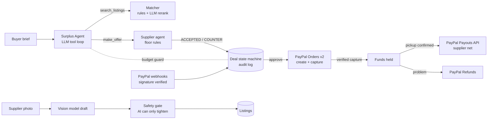

# Waste2Worth: Surplus Agent

**An AI procurement agent that sources reusable industrial surplus, negotiates with the supplier's agent, and settles through PayPal: the buyer pays, the platform holds the funds, and the supplier is paid out when pickup is confirmed.**

Small manufacturers throw away clean offcuts (fabric, untreated wood, kraft board) that other small businesses would pay for, but nobody has time to find the material, haggle over a lot of 200 kg, and trust a stranger with payment. Waste2Worth turns that into one sentence:

> “200 kg clean cotton fabric for protective packaging, under $300, near Austin”

The **Surplus Agent** searches the marketplace and opens an offer below list price. The supplier's **negotiation agent** answers inside the floor the supplier set. The buyer gets a negotiated deal to approve in **PayPal**. Money is captured and held, released to the supplier with the **PayPal Payouts API** after pickup, or refunded through the **Refunds API** if the material isn't as described.

Built for the [PayPal AI Hackathon](https://paypalaihackathon.devpost.com/). MIT licensed.

## What it does

| | |
|---|---|
| **Agentic buying** | A tool-calling LLM agent (`search_listings`, `make_offer`, `accept_counter`, `finish`) negotiates for the buyer. Every step is shown as a live trace. A server-side **budget guard** rejects any offer over the buyer's budget, whatever the model says. |
| **Agent-to-agent negotiation** | Each listing has a supplier-set floor. The supplier agent accepts, counters or declines automatically (bulk orders unlock the floor), or holds the offer for a human when auto-negotiate is off. |
| **Marketplace money movement** | PayPal **Orders v2** create and capture with server-side reconciliation (amount, currency and payee must match). Funds are held, then the **Payouts API** sends the supplier their share minus a 5% platform fee. **Refunds** run before payout, and **webhooks** are checked with PayPal's signature verification. |
| **Vision listing assistant** | Suppliers snap a photo. An open-weight vision model drafts the title, family, condition, likely uses and what a buyer should confirm, and flags safety. It can abstain. |
| **Safety that AI can't loosen** | The server's rule gate always runs. The AI can only make a listing *stricter* (review or block), never approve something the rules block. |
| **AI matching** | An LLM extracts intent (family, quantity, budget, location, use) and re-ranks rule-scored listings with plain-language reasons. |
| **One audited state machine** | `NEGOTIATING → COUNTERED/ACCEPTED → PAYMENT_PENDING → PAID_HELD → PICKUP_CONFIRMED → PAYOUT_SENT → SUPPLIER_PAID`, plus `REFUNDED`, `CANCELLED` and `RECONCILIATION_REQUIRED`. Stock is reserved on acceptance. Every transition is logged with its actor (buyer, buyer-agent, supplier-agent, paypal, paypal-webhook). |
| **Honest impact** | The Impact page counts only material in *paid* deals and keeps catalog potential and demo payments clearly separate. It makes no carbon claims. |

## Architecture



- `server.mjs`: HTTP routes, sessions, static files
- `lib/agent.mjs`: the buyer agent (LLM tool loop, plus a deterministic rules agent with the same tools)
- `lib/deals.mjs`: state machine, stock reservation, supplier negotiation rules
- `lib/paypal.mjs`: OAuth, Orders v2, capture reconciliation, Refunds, Payouts, webhook verification
- `lib/ai.mjs`: OpenAI-compatible client for Groq, Ollama or OpenRouter; listing drafts, intent, re-ranking
- `lib/match.mjs`, `lib/safety.mjs`: transparent scoring and the safety gate
- `lib/store.mjs`: JSON file locally, Postgres (Neon) when `DATABASE_URL` is set, images included
- `public/`: no-build vanilla JS front end
- `test/`: `node --test` suites for the state machine, safety, the agent (with mocked LLM tool calls) and PayPal (mocked API)

## Tools used

| Tool | How it's used |
|---|---|
| **PayPal Orders v2 + JS SDK Buttons** | Buyer approval, then server-side capture of the negotiated amount, with idempotency keys and payee, amount and currency reconciliation |
| **PayPal Payouts API** | Releases the supplier's net amount after pickup is confirmed |
| **PayPal Refunds API** | Full refund of a held capture before payout; stock is returned to the listing |
| **PayPal Webhooks** | Capture, refund and payout events, checked with `verify-webhook-signature` and processed idempotently |
| **Groq (free tier)** running open-weight **gpt-oss-120b** | Agent tool calling, intent extraction, re-ranking |
| **Qwen3.8 (open-weight vision)** on Groq | Photo-to-listing drafts with safety flags |
| **Ollama** (optional) | Runs the same features fully locally with open-source models |
| **Render** + **Neon Postgres** (free tiers) | Hosting and persistent storage for listings, deals, audit events and photos |

No paid AI is required. Without any key the app runs a deterministic rules agent with the same tools, so judges can always run it.

## Run locally

Requires Node.js 20+.

```bash
git clone https://github.com/car-ui/waste2worth && cd waste2worth
npm install
npm start            # http://localhost:4173
npm test             # 22 tests
npm run reset        # wipe deals/listings (local file or Neon) before a demo
```

With no `.env` the app runs fully: a rules-based agent, and demo payments that are clearly labelled and move no money. To turn on the real integrations, `cp .env.example .env` and fill in:

1. **AI (free):** create a key at [console.groq.com/keys](https://console.groq.com/keys) and set `AI_API_KEY`. For a fully local setup, use `AI_PROVIDER=ollama` with `ollama pull qwen2.5:7b` and `ollama pull llama3.2-vision`.
2. **PayPal Sandbox (free):** at [developer.paypal.com](https://developer.paypal.com/dashboard/applications/sandbox), create an app and set `PAYPAL_CLIENT_ID` and `PAYPAL_CLIENT_SECRET`.
   - Set `PAYPAL_MERCHANT_ID` to the merchant ID of the Sandbox **business** account (the platform).
   - Set `SUPPLIER_PAYOUT_EMAIL` to the email of a second Sandbox account, which receives supplier payouts. Make sure **Payouts** is enabled on the app.
3. **Webhooks (optional):** add `https://<host>/api/paypal/webhook` to the app, subscribe to `PAYMENT.CAPTURE.*` and `PAYMENT.PAYOUTS-ITEM.*`, and set `PAYPAL_WEBHOOK_ID`.

## Try it (about 3 minutes)

1. **Buyer view** (default persona Priya at Northwind Packaging Lab): click **Send agent** with the prefilled brief and watch the trace: search, offer, the supplier agent's reply.
2. Click **Review & approve payment** and pay with your PayPal **Sandbox personal** account. You land on **Deals** with status *Paid · funds held*.
3. Click **Confirm pickup & release payout**. A Payouts API batch is sent, and the deal moves to *Supplier paid* once PayPal reports success.
4. Make a manual low offer on any listing to see a **counter-offer**. Use **Problem? Refund** on a held deal to test refunds.
5. Switch the persona to **Supplier · Davis Reclaim Co.** Turn off **Agent** on a listing, send an offer as the buyer, and answer it in the supplier inbox. Then **Post material** with a photo and click **Suggest details** to see the vision draft. A description like "oil-soaked rags" is blocked whatever the AI says.

## Deploy (free)

Both options use a free [Neon](https://neon.tech) Postgres database. Copy its connection string for `DATABASE_URL`.

**Hugging Face Spaces (Docker, no card):**
1. Create a Docker Space (Blank template, CPU basic).
2. In the Space settings, add secrets: `AI_API_KEY`, `PAYPAL_CLIENT_ID`, `PAYPAL_CLIENT_SECRET`, `PAYPAL_MERCHANT_ID`, `SUPPLIER_PAYOUT_EMAIL`, `DATABASE_URL` and `SESSION_SECRET`.
3. Run `git remote add hf https://huggingface.co/spaces/<user>/<space>` and then `bash scripts/deploy-hf.sh`. The script adds the Space config to the README in a throwaway commit, so the GitHub README stays clean.

**Render:** go to **New → Blueprint** and pick this repo. `render.yaml` defines the service; fill in the `sync: false` env vars in the dashboard.

Then add `https://<host>/api/paypal/webhook` as a webhook in the PayPal app and set `PAYPAL_WEBHOOK_ID`.

## Boundaries (stated honestly)

- **Demo data:** listings, suppliers, prices and freight are synthetic. Freight is a comparison estimate, not a carrier quote.
- **Personas:** two demo personas with signed session cookies stand in for real accounts. The server enforces their roles (only the buyer can pay or confirm pickup; only the owning supplier can answer offers), but there is no sign-up or password.
- **Payouts:** one Sandbox payout receiver stands in for all suppliers.
- **Safety and composition:** the safety gate is a screening aid, not certification. Buyers confirm the material at pickup before releasing funds.

## What was built during the hackathon

The repo began on Oct 23, 2026 as a single-flow prototype: a rule matcher, one-merchant Sandbox checkout and local receipts. During the submission period it gained:
- the LLM buyer agent with its budget guard, and the supplier negotiation agent;
- the deal state machine with stock reservation and an audit log;
- PayPal Payouts, Refunds and webhook verification;
- vision listing drafts and the AI-can-only-tighten safety gate;
- AI intent extraction and re-ranking;
- server-enforced personas;
- Postgres and photo storage, and Render deployment;
- the test suites.
